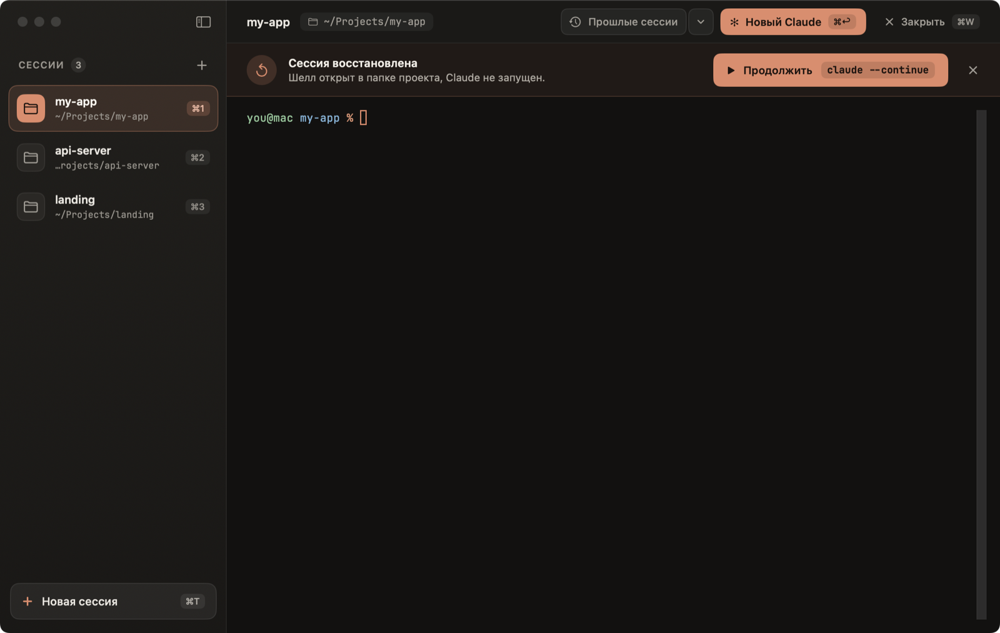

# Eremos Terminal

**A native macOS app for running several [Claude Code](https://docs.anthropic.com/en/docs/claude-code) sessions side by side.**
Sessions on the left, the selected session's terminal on the right. Each session is a folder with its own
`zsh`. You start Claude with a button, and the app tells you when Claude has finished or needs your input.

[Русская версия](README.ru.md)



> The interface is in Russian for now. Pull requests that add localization are welcome.

## Features

- **One window, many projects.** Every session is a real terminal (`zsh -l`) in its own folder. Switching
  between sessions is instant, and scrollback and running processes are kept.
- **Claude buttons.** «Новый Claude» (new conversation, `claude`), «Прошлые сессии» (pick a past
  conversation, `claude --resume`) and «Продолжить» (continue the last one, `claude --continue`).
  While Claude is running, a «Claude работает» badge replaces the buttons.
- **Notifications.** When Claude finishes or needs you (a permission prompt or a question) in a session
  you're not looking at, you get:
  - a macOS notification;
  - a mark next to the session;
  - a count on the Dock icon;
  - a Dock bounce.
- **Sessions survive restarts.** After relaunching, every session reopens its shell in the same folder. If
  Claude has talked in that folder before, a banner offers to continue the conversation.
- **Your setup stays yours.** Your `.zshrc`, `.zprofile`, history and Claude Code settings are used as they
  are. Nothing in them is changed.
- Dark theme, JetBrains Mono font (bundled), drag a folder onto the Dock icon to open it.

## Requirements

- macOS 14 Sonoma or later, Apple Silicon or Intel.
- [Claude Code](https://docs.anthropic.com/en/docs/claude-code) installed, with `claude` available in
  your login `zsh` (it works if `claude` runs in Terminal.app).

## Install

### Download

1. Download `Eremos-Terminal-<version>.zip` from
   [Releases](https://github.com/matveevvadim27/eremos-terminal/releases/latest), unzip it and move
   **Eremos Terminal.app** to **Applications**.
2. On first launch macOS will block the app. It isn't signed with an Apple Developer ID, so Apple can't
   check it. Allow it once:
   - open the app, then go to **System Settings → Privacy & Security** and click **Open Anyway**;
   - or run this in Terminal:
     ```bash
     xattr -dr com.apple.quarantine "/Applications/Eremos Terminal.app"
     ```

If you'd rather not run a downloaded binary, build it yourself. It takes about a minute.

### Build from source

You need Xcode 15+ and [XcodeGen](https://github.com/yonaskolb/XcodeGen):

```bash
brew install xcodegen
git clone https://github.com/matveevvadim27/eremos-terminal.git
cd eremos-terminal
make install    # builds a Release version and copies it to /Applications
```

## Usage

| Action | |
|---|---|
| ⌘T or «+» | New session: a terminal in your home folder |
| ⌘O or the «+» menu | New session in a folder you pick |
| Drag a folder onto the Dock icon | New session in that folder (or `open -a "Eremos Terminal" ~/path`) |
| «Новый Claude», ⌘↩ | `claude`: start a new conversation |
| «Прошлые сессии», ⌥⌘↩ | `claude --resume`: choose from past conversations in this folder |
| Arrow next to «Прошлые сессии», ⇧⌘↩ | `claude --continue`: resume the last conversation |
| ⌘1…⌘9 | Switch to a session |
| ⌃⌘S | Show / hide the session list |
| Double-click a session | Rename it (Enter saves, Esc cancels, an empty name restores the default) |
| ⌘W | Close the session. Its shell and everything running in it are ended |

The dot on a session's icon shows its state:

| Dot | Meaning |
|---|---|
| green | Claude is running |
| red | the shell has exited (restart it from the banner) |
| yellow | the folder no longer exists |

Closing the window keeps the sessions running. Click the Dock icon to bring the window back. ⌘Q ends them.

### Notifications and Focus mode

macOS asks for permission on the first notification. If a Focus mode (Do Not Disturb, etc.) is on,
banners are delivered silently to Notification Center. To get them anyway, add Eremos Terminal under
**System Settings → Focus → *your mode* → Allowed Notifications → Apps**. The Dock bounce works
regardless of Focus.

## How it works

- **Terminal.** [SwiftTerm](https://github.com/migueldeicaza/SwiftTerm) runs `zsh -l` in each session's
  folder, so `PATH` and everything else is the same as in Terminal.app.
- **Claude detection.** Once a second the app checks each shell's child processes to see whether `claude`
  is running. This drives the buttons and the green dot.
- **Notifications.** Done through [Claude Code hooks](https://docs.anthropic.com/en/docs/claude-code/hooks).
  - Shells start with `ZDOTDIR` pointing at a small `.zshenv` owned by the app. It puts your own `ZDOTDIR`
    back, so your startup files load as usual.
  - It also defines a `claude` shell function that adds `--settings <the app's hooks file>`.
  - The hooks append a line to a per-session events file, and the app reads these files.
  - This is why `claude` typed by hand also triggers notifications. Subcommands (`claude mcp`,
    `claude update`, …) run untouched.

### Files and privacy

The app makes no network requests. Everything it writes is in
`~/Library/Application Support/Eremos Terminal/`:

| File | Contents |
|---|---|
| `sessions.json` | the session list: names and folders |
| `claude-settings.json` | the hooks passed to `claude --settings` |
| `zsh/.zshenv` | the shell wrapper described above |
| `events/` | short-lived hook events, deleted once read |

It reads Claude Code's `~/.claude/projects/` (or `$CLAUDE_CONFIG_DIR/projects/`) only to check whether a
folder has past conversations. It never writes there.

**Uninstall:** quit the app, delete it from Applications and delete
`~/Library/Application Support/Eremos Terminal/`.

## Known limitations

- **Interface only in Russian, dark theme only.**
- **zsh only.** Sessions always run `zsh`, the macOS default shell.
- **Typing `claude` by hand needs the shell function.** If your `.zshrc` defines an alias named `claude`,
  the wrapper is bypassed and you won't get notifications for that `claude`.
- **The green dot doesn't tell "thinking" from "waiting for you".** The notification mark does.
- **Option works as Meta** (SwiftTerm's default). ⌥←/⌥→ move by word, but characters typed with Option
  don't work in the terminal.
- **Not signed or notarized**, see [Install](#install).

## Development

```bash
make open       # generate the Xcode project and open it (⌘R run, ⌘U tests)
make test       # unit tests
make run        # Release build and launch
make dist       # zip for a GitHub release → dist/
```

- `EremosTerminal.xcodeproj` isn't in git. `make project` generates it from `project.yml`, and new files
  under `EremosTerminal/` are picked up automatically.
- When you first open the project, Xcode asks whether to trust the SwiftTerm package plugin. Choose
  «Trust & Enable». The Makefile passes `-skipPackagePluginValidation` instead.

To run a development build next to an installed copy without touching its sessions:

```bash
EREMOS_TERMINAL_SESSIONS_FILE=/tmp/dev-sessions.json \
  "build/Build/Products/Release/Eremos Terminal.app/Contents/MacOS/Eremos Terminal"
```

<details>
<summary>Project structure</summary>

```
EremosTerminal/
├── App/            entry point, menus and shortcuts, window chrome, notifications
├── Models/         Session, SessionStore (sessions, selection, live terminals, status polling)
├── Persistence/    sessions.json
├── Terminal/       terminal creation and theme, bundled font, process tree,
│                   Claude detection, hooks integration, Claude history lookup
├── Views/          theme tokens, sidebar, header, banners, empty state
└── Resources/      app icon, JetBrains Mono, Info.plist additions
```

</details>

## License

[MIT](LICENSE). The bundled JetBrains Mono font is under the
[SIL Open Font License 1.1](EremosTerminal/Resources/Fonts/JetBrainsMono-OFL.txt).

Eremos Terminal is an independent project. It isn't affiliated with or endorsed by Anthropic.
«Claude» and «Claude Code» are trademarks of Anthropic.
