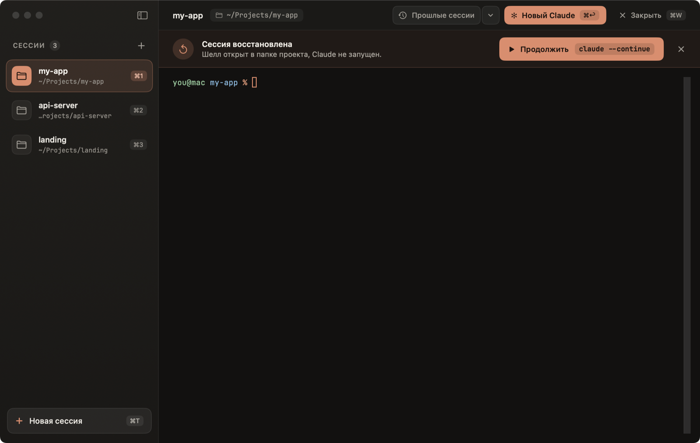

# Eremos Terminal

**Нативное macOS-приложение, чтобы вести несколько сессий [Claude Code](https://docs.anthropic.com/en/docs/claude-code) в одном окне.**
Слева список сессий, справа терминал выбранной. Каждая сессия — своя папка и свой `zsh`. Claude
запускается кнопкой, а приложение сообщает, когда он закончил или ждёт ответа.

[English version](README.md)



## Возможности

- **Одно окно, много проектов.** Каждая сессия — настоящий терминал (`zsh -l`) в своей папке.
  Переключение мгновенное, история и запущенные процессы сохраняются.
- **Кнопки Claude:**
  - «Новый Claude» — новый разговор (`claude`);
  - «Прошлые сессии» — выбрать прошлый разговор (`claude --resume`);
  - «Продолжить» — последний разговор (`claude --continue`).

  Пока Claude работает, вместо кнопок метка «Claude работает».
- **Уведомления.** Когда Claude закончил или ждёт ответа (разрешение, вопрос) в сессии, которая
  сейчас не на экране, приходят:
  - системное уведомление;
  - значок у сессии;
  - число на иконке в Dock;
  - прыжок иконки.
- **Сессии переживают перезапуск.** После перезапуска каждая сессия открывает шелл в той же папке. Если
  там уже были разговоры с Claude, баннер предложит продолжить последний.
- **Ваши настройки не трогаются.** `.zshrc`, `.zprofile`, история и настройки Claude Code работают как есть
  и не меняются.
- Тёмная тема, встроенный шрифт JetBrains Mono, папку можно перетащить на иконку в Dock.

## Требования

- macOS 14 Sonoma или новее, Apple Silicon или Intel.
- Установленный [Claude Code](https://docs.anthropic.com/en/docs/claude-code): `claude` должен
  запускаться в обычном Терминале.

## Установка

### Скачать готовое

1. Скачайте `Eremos-Terminal-<версия>.zip` в
   [Releases](https://github.com/matveevvadim27/eremos-terminal/releases/latest), распакуйте и перенесите
   **Eremos Terminal.app** в «Программы».
2. При первом запуске macOS заблокирует приложение: оно не подписано Apple Developer ID, и Apple не может
   его проверить. Разрешите один раз:
   - откройте приложение, затем «Системные настройки → Конфиденциальность и безопасность» →
     «Всё равно открыть»;
   - или выполните в Терминале:
     ```bash
     xattr -dr com.apple.quarantine "/Applications/Eremos Terminal.app"
     ```

Если не хочется запускать скачанный файл, соберите сами — это около минуты.

### Собрать из исходников

Нужны Xcode 15+ и [XcodeGen](https://github.com/yonaskolb/XcodeGen):

```bash
brew install xcodegen
git clone https://github.com/matveevvadim27/eremos-terminal.git
cd eremos-terminal
make install    # собирает Release и копирует в /Applications
```

## Как пользоваться

| Действие | |
|---|---|
| ⌘T или «+» | новая сессия: терминал в домашней папке |
| ⌘O или меню у «+» | новая сессия в выбранной папке |
| перетащить папку на иконку в Dock | новая сессия в этой папке (или `open -a "Eremos Terminal" ~/путь`) |
| «Новый Claude», ⌘↩ | `claude` — новый разговор |
| «Прошлые сессии», ⌥⌘↩ | `claude --resume` — выбрать из прошлых разговоров в этой папке |
| стрелка у «Прошлых сессий», ⇧⌘↩ | `claude --continue` — продолжить последний разговор |
| ⌘1…⌘9 | переключиться на сессию |
| ⌃⌘S | скрыть / показать список сессий |
| двойной клик по сессии | переименовать: Enter — сохранить, Esc — отмена, пустое имя — исходное |
| ⌘W | закрыть сессию: шелл и всё, что в нём запущено, завершаются |

Точка на иконке сессии показывает её состояние:

| Точка | Значение |
|---|---|
| зелёная | Claude работает |
| красная | терминал завершился (перезапуск — в баннере) |
| жёлтая | папки больше нет |

Закрытие окна не завершает сессии — окно вернётся по клику на иконку в Dock. ⌘Q завершает всё.

### Уведомления и «Фокусирование»

При первом уведомлении macOS спросит разрешение. Если включён режим «Фокусирование» («Не беспокоить»
и т.п.), баннеры тихо уходят в Центр уведомлений. Чтобы они приходили и в этом режиме, добавьте
Eremos Terminal в «Системные настройки → Фокусирование → *режим* → Разрешённые уведомления → Приложения».
Прыжок иконки в Dock работает в любом режиме.

## Как это устроено

- **Терминал.** [SwiftTerm](https://github.com/migueldeicaza/SwiftTerm) запускает `zsh -l` в папке
  сессии, поэтому `PATH` и всё остальное такие же, как в Терминале.
- **Запущен ли Claude.** Раз в секунду приложение смотрит дочерние процессы шелла: есть ли среди них
  `claude`. От этого зависят кнопки и зелёная точка.
- **Уведомления** работают через [hooks Claude Code](https://docs.anthropic.com/en/docs/claude-code/hooks).
  - Шелл запускается с `ZDOTDIR`, указывающим на небольшой `.zshenv` приложения. Тот возвращает ваш
    `ZDOTDIR`, так что ваши файлы загружаются как обычно.
  - Ещё он объявляет функцию `claude`, которая добавляет `--settings <файл с hooks>`.
  - Hooks дописывают строку в файл событий сессии, приложение читает эти файлы.
  - Поэтому уведомления приходят и для `claude`, набранного руками. Подкоманды (`claude mcp`,
    `claude update`…) идут без изменений.

### Файлы и приватность

Приложение не ходит в сеть. Всё, что оно пишет, лежит в
`~/Library/Application Support/Eremos Terminal/`:

| Файл | Что внутри |
|---|---|
| `sessions.json` | список сессий: имена и папки |
| `claude-settings.json` | hooks для `claude --settings` |
| `zsh/.zshenv` | обёртка шелла, описанная выше |
| `events/` | временные события hooks, удаляются после чтения |

Папку Claude Code `~/.claude/projects/` (или `$CLAUDE_CONFIG_DIR/projects/`) приложение только читает,
чтобы понять, были ли в папке разговоры. Туда оно ничего не пишет.

**Удаление:** закройте приложение, удалите его из «Программ» и удалите папку
`~/Library/Application Support/Eremos Terminal/`.

## Известные ограничения

- **Только тёмная тема.**
- **Только zsh.** Сессии всегда запускают `zsh` — шелл macOS по умолчанию.
- **`claude`, набранный руками, работает через функцию шелла.** Если в `.zshrc` есть алиас `claude`, обёртка
  не сработает, и уведомлений от такого `claude` не будет.
- **Зелёная точка не различает «думает» и «ждёт вас».** Это видно по значку уведомления.
- **Option работает как Meta** (настройка SwiftTerm по умолчанию): ⌥←/⌥→ двигают по словам, но символы,
  которые набираются через Option, в терминале не наберутся.
- **Нет подписи и нотаризации Apple**, см. [Установка](#установка).

## Разработка

```bash
make open       # сгенерировать проект Xcode и открыть (⌘R — запуск, ⌘U — тесты)
make test       # юнит-тесты
make run        # собрать Release и запустить
make dist       # zip для GitHub Release → dist/
```

- `EremosTerminal.xcodeproj` не хранится в git: его генерирует `make project` из `project.yml`. Новые
  файлы в `EremosTerminal/` попадают в проект сами.
- При первом открытии проекта Xcode спросит, доверять ли плагину пакета SwiftTerm: выберите
  «Trust & Enable». В Makefile вместо этого передаётся флаг `-skipPackagePluginValidation`.

Dev-сборку можно запустить рядом с установленной, не трогая её сессии:

```bash
EREMOS_TERMINAL_SESSIONS_FILE=/tmp/dev-sessions.json \
  "build/Build/Products/Release/Eremos Terminal.app/Contents/MacOS/Eremos Terminal"
```

<details>
<summary>Устройство проекта</summary>

```
EremosTerminal/
├── App/            точка входа, меню и горячие клавиши, окно без заголовка, уведомления
├── Models/         Session, SessionStore (сессии, выбор, живые терминалы, опрос статусов)
├── Persistence/    sessions.json
├── Terminal/       создание терминала и его тема, встроенный шрифт, дерево процессов,
│                   определение Claude, интеграция через hooks, история Claude
├── Views/          токены темы, сайдбар, шапка, баннеры, пустое состояние
└── Resources/      иконка, JetBrains Mono, дополнения к Info.plist
```

</details>

<details>
<summary>Для тех, кто пришёл из React</summary>

- **`SessionStore` — как стор Zustand/MobX.** `@Observable` сам отслеживает, какие свойства читает каждый
  view, и перерисовывает только их. Он создаётся один раз через `@State`, как
  `useState(() => new Store())`.
- **Терминалы не в состоянии SwiftUI.** Это AppKit-объекты с живыми процессами. Они лежат в словаре внутри
  стора (`@ObservationIgnored`), создаются один раз и только переставляются. Ничего не размонтируется,
  поэтому история не теряется.
- **`TerminalContainerView` (`NSViewRepresentable`)** — как компонент с `useRef` на `<div>`, внутри которого
  рисует императивная библиотека: `makeNSView` — монтирование, `updateNSView` — ререндер.
- **`@MainActor`** — код, который выполняется в главном (UI) потоке; компилятор это проверяет.

</details>

## Лицензия

[MIT](LICENSE). Встроенный шрифт JetBrains Mono распространяется по
[SIL Open Font License 1.1](EremosTerminal/Resources/Fonts/JetBrainsMono-OFL.txt).

Eremos Terminal — независимый проект, не связанный с Anthropic. «Claude» и «Claude Code» — товарные
знаки Anthropic.
